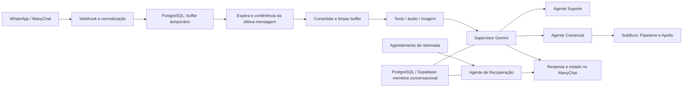
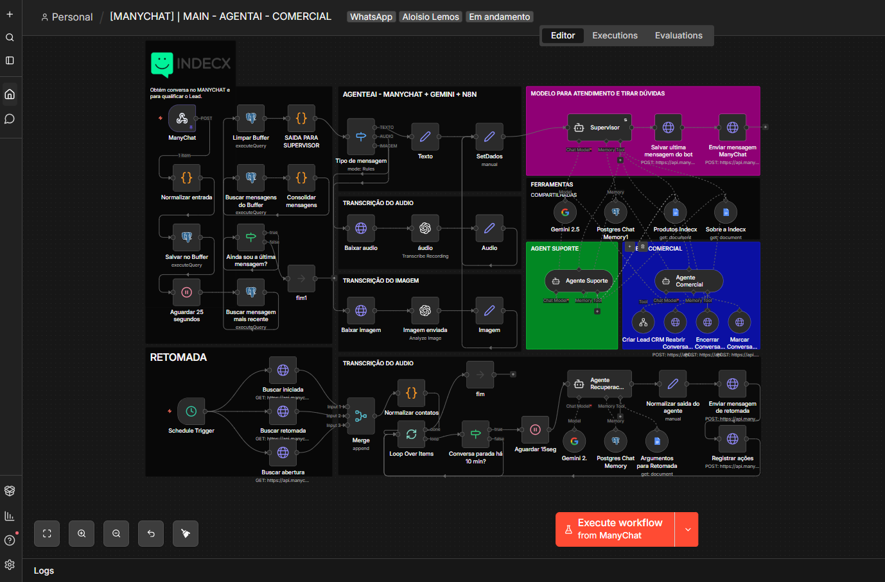

# Atendimento Multimodal com IA — ManyChat, n8n e CRM

Um dos primeiros agentes conversacionais que construí para **dar continuidade aos contatos do WhatsApp e levar oportunidades ao CRM com contexto**. Integrei ManyChat, n8n, Gemini, OpenAI, Pipedrive, Apollo e memória conversacional em **PostgreSQL/Supabase**.

## O problema que procurei resolver

Contatos chegavam pelo WhatsApp, mas podiam ficar sem retorno, perder continuidade no comercial ou entrar no CRM com dados incompletos. Desenvolvi uma operação que recebe mensagens, agrupa interações próximas, identifica a intenção, direciona suporte e vendas e prepara retomadas de conversas elegíveis.

O projeto marcou minha evolução: passei de integrações pontuais para uma arquitetura com supervisor, agentes especializados, ferramentas, memória e ações nos sistemas da operação.

## Resultado na operação

Na experiência que compartilhei no [LinkedIn](https://lnkd.in/p/dWbKfMKH), o projeto contribuiu para a **conversão de mais de 41 leads**, no intervalo citado no post, desde 1º de setembro até sua publicação. O número reflete meu acompanhamento operacional; não representa contratos fechados, receita ou atribuição isolada à IA. Não publiquei dados dos leads ou uma conciliação desse total.

Minha intenção foi aproveitar melhor oportunidades e solicitações de contato sem ampliar a estrutura operacional. Não apresento aqui uma medição de redução de custos.

## Arquitetura

O núcleo tem **quatro agentes**: supervisor, suporte, comercial e recuperação comercial. O subfluxo comercial também contém uma etapa histórica Definir Owner, desabilitada no arquivo de origem.

## Diferenciais

- Entrada por webhook e buffer para reduzir respostas fragmentadas.
- Texto, transcrição de áudio e análise de imagem convergindo para o atendimento.
- Memória conversacional persistida em PostgreSQL, hospedado no Supabase na minha implementação.
- Conhecimento de empresa e produtos consultado por ferramentas de documentos.
- Criação/atualização de registros no Pipedrive e enriquecimento via Apollo.
- Marcação, reabertura, encerramento e registro de estado no ManyChat.
- Retomada contextualizada com critérios de tempo e tentativas.
- Atendimento orientado pelo prompt a responder no idioma do contato; sem benchmark multilíngue nesta publicação.

## Screenshots

**Imagem preparada:** envie o arquivo com o nome exato **atendimento-multimodal.png** para **assets/screenshots/**. O README já aponta para esse caminho; a imagem aparecerá após o upload.

## Templates públicos

| Fluxo | Nós | Uso |
| --- | ---: | --- |
| [Principal](workflows/principal.template.json) | 61 | Atendimento e retomada |
| [Comercial](workflows/comercial.template.json) | 27 | CRM e enriquecimento |
| [Suporte histórico](workflows/suporte.template.json) | 4 | Referência de envio de reclamação por e-mail; fora do atendimento atual |

Todos estão **inativos**, sem credenciais ou dados fixados e com integrações desabilitadas. Os prompts públicos são demonstrações generalizadas. O material não inclui bases internas de conhecimento, contatos reais ou uma instância funcional configurada.

## Explore o projeto

- [Contexto, importância e evolução](docs/contexto-impacto.md)
- [Buffer: agrupamento e concorrência](docs/buffer.md)
- [Memória conversacional e Supabase](docs/memoria.md)
- [Agentes, ferramentas e conhecimento](docs/agentes.md)
- [Atendimento por texto, áudio e imagem](docs/multimodalidade.md)
- [Qualificação, Pipedrive e Apollo](docs/comercial-crm.md)
- [Retomada e continuidade](docs/retomada.md)
- [Suporte atual e fluxo histórico](docs/suporte.md)
- [Integrações e escopo do post](docs/integracoes.md)
- [Configuração e imagem](docs/configuracao.md)
- [Inventário dos nós e código](docs/inventario.md)
- [Preparação pública](docs/publicacao.md)
- [Validação e limites](docs/validacao.md)

## Próximos passos

Quero aprofundar a engenharia dos agentes e evoluir a arquitetura com ferramentas como Claude Code e Codex e integrações por MCP. Isso é uma direção de evolução, não uma funcionalidade implementada nos templates publicados.
